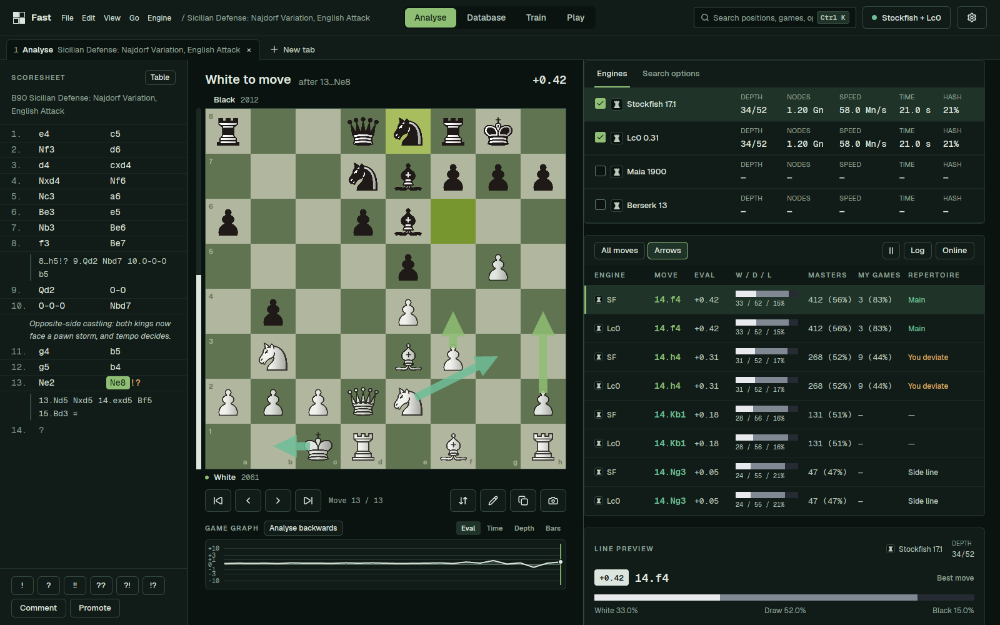

# Fast

A native desktop chess workstation in Rust and [GPUI](https://www.gpui.rs): analysis with
multiple UCI engines, game databases, repertoire training, play against engines and
fastchess tournaments. Offline and single-user.

**Documentation:** https://disservin.github.io/fast/



## Build and run

Requires a stable Rust toolchain (edition 2024). On Debian/Ubuntu, install:

```sh
sudo apt install libfontconfig-dev libfreetype-dev libxkbcommon-dev \
  libxkbcommon-x11-dev libwayland-dev libxcb1-dev libasound2-dev
```

```sh
cargo run --release -p fast            # your real profile
cargo run --release -p fast -- --demo  # separate generated profile, scripted engine output
```

`--demo` uses its own `fast-demo` directories and needs no engines installed.
`--screen analyse|database|train|play|tournament|test-positions|settings[:engines|board|databases|shortcuts|data]`
picks the first screen.

Under WSLg, if the window fails to open, set `XDG_RUNTIME_DIR=/mnt/wslg/runtime-dir` or
unset `WAYLAND_DISPLAY` to fall back to X11.

## Workspace

| Crate | Contents |
| --- | --- |
| `chess_core` | Game tree with variations and annotations, PGN/FEN/EPD, notation, opening classifier |
| `engine` | UCI parser, engine process supervision, analysis streams |
| `db` | SQLite game databases (one file each), import, position search by Zobrist hash |
| `trainer` | Repertoire tree, spaced-repetition scheduler, leak detection |
| `ui` | Theme tokens, i18n, shared widgets, board, scoresheet and graphs |
| `app` (package `fast`) | Window, tabs, screens and configuration |

`chess_core`, `engine`, `db` and `trainer` have no GPUI dependency. See
[ARCHITECTURE.md](ARCHITECTURE.md) for threads, the engine protocol and data flow, and
[AGENTS.md](AGENTS.md) for the design spec and code style.

## Develop

CI runs:

```sh
cargo fmt --all -- --check
cargo clippy --workspace --all-targets -- -D warnings
cargo test --workspace
cargo build --release -p fast
```

- `python3 scripts/third_party.py` regenerates `crates/app/third_party.json` after
  dependency changes; a test fails when it no longer matches `Cargo.lock`.
- `python3 scripts/update_openings.py` refreshes the bundled Lichess opening data.
- Engine download entries live in [config/engines.json](config/engines.json)
  ([guide](config/README.md), [schema](config/engines.schema.json)).
- Translations live in `crates/ui/src/i18n.rs`.
- Release packaging: [packaging/README.md](packaging/README.md). The Release workflow
  builds Windows, macOS and Linux packages and publishes a tagged release.
- Documentation site: [website/README.md](website/README.md).

## Thanks

Thanks to [En Croissant](https://github.com/franciscoBSalgueiro/en-croissant) and its
contributors, whose project history and community requests were valuable references.
